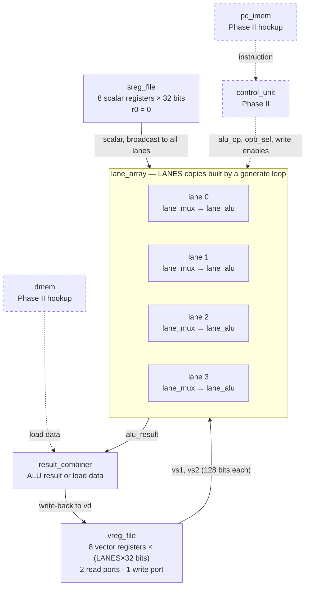
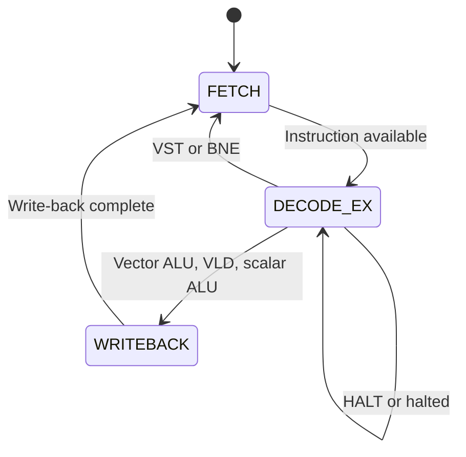

# SIMD Vector Processing Unit

**Project 11 · SIMD / Parallelism · Team LANE BREAKERS**
Modern Computer Architecture — Newton School of Technology, Rishihood University

A parameterized **Single Instruction, Multiple Data (SIMD)** vector processing unit in synthesizable Verilog-2001. One instruction drives every lane, so a 4-lane build performs four 32-bit operations in a single clock cycle.

---

## Phase I Submission

> [!IMPORTANT]
> **IEEE Report (PDF):** [report/SIMD_VPU_Phase1_Report.pdf](report/SIMD_VPU_Phase1_Report.pdf)
>
> **Prototype Demo Video:** [Phase I Prototype Demo (Google Drive)](https://drive.google.com/file/d/1J8yfL7EDzvQIP1-MFa14KIe3Ny5_jfE6/view?usp=sharing)

### Project Artefacts

| Artefact | Location |
|---|---|
| RTL source | [`rtl/`](rtl/) |
| Testbenches | [`tb/`](tb/) — 203 RTL checks, all passing |
| Golden model | [`verif/golden.py`](verif/golden.py) |
| Design docs | [`docs/`](docs/) — spec, ISA, interfaces, control FSM, per-module docs |
| Synthesis script | [`synth/run_synth.tcl`](synth/run_synth.tcl) — Vivado, Artix-7 |

---

## Team

| Member | Role | Phase I Work |
|---|---|---|
| **Dhanvin Vadlamudi** (Team Lead) | Datapath RTL | `lane_alu`, `lane_mux`, `lane_array`, `vreg_file`, `sreg_file`, `result_combiner` |
| **Kasula Lalithendra** | Architecture & Integration | Spec, interfaces, block diagram, `vpu_demo_top`, Makefile |
| **Jagruthi Pulumati** | Control & Memory | ISA, control FSM design, `dmem`, `pc_imem` + tests |
| **Polana Rakshita** | Verification | `golden.py`, ALU / mux / lane-array / register-file testbenches, verification plan |
| **Chaitanya Sai Meka** | Report & Synthesis | IEEE report, literature review, Vivado synthesis script |

---

## The Idea in One Picture

A scalar processor needs one instruction per element. A SIMD processor applies one instruction to every lane at once.

```
 Scalar: 4 instructions, 4 steps      SIMD, LANES = 4: 1 instruction, 1 step

   step 1:  1 + 10 = 11                         VADD v2, v0, v1
   step 2:  2 + 11 = 13                 ┌─────────┬──────┴──┬─────────┐
   step 3:  3 + 12 = 15                 ▼         ▼         ▼         ▼
   step 4:  4 + 13 = 17               lane 0    lane 1    lane 2    lane 3
                                      1+10=11   2+11=13   3+12=15   4+13=17
                                      └──── all four in ONE clock cycle ────┘
```

---

## Architecture

The VPU is a single-issue Harvard machine. Vector registers are flat `LANES × 32`-bit buses; lane *i* occupies bits `[i*32 +: 32]`. Changing the `LANES` parameter (1, 2, 4, 8) rescales the register file, lane array and memory width with no RTL edits.



Solid paths are built and tested in Phase I. Dashed blocks are Phase II: `dmem` and `pc_imem` are implemented and unit-tested but not yet connected; the control unit is designed (see [`docs/control_fsm.md`](docs/control_fsm.md)). In Phase I the testbench drives the control signals through `vpu_demo_top`.

### Modules

| Module | Function | Status |
|---|---|---|
| `lane_alu` | Combinational 32-bit ALU, 9 operations via 4-bit `alu_op` | Built + tested |
| `lane_mux` | Operand B: own `vs2` element, or scalar broadcast (`opb_sel`) | Built + tested |
| `lane_array` | `generate` loop creating `LANES` mux + ALU pairs | Built + tested at 1/4/8 lanes |
| `vreg_file` | 8 vector registers, async read, sync write | Built + tested |
| `sreg_file` | 8 scalar registers, `r0` hard-wired to 0 | Built + tested |
| `result_combiner` | Write-back select: ALU result or memory data | Built + tested |
| `dmem` | One `LANES×32`-bit vector per address | Built + tested (standalone) |
| `pc_imem` | Program counter with branch + instruction memory | Built + tested (standalone) |
| `vpu_demo_top` | Phase I integrated datapath | Built + tested |
| `control_unit` | FETCH → DECODE/EXECUTE → WRITEBACK FSM | Designed — Phase II |

### ALU operations

| `alu_op` | Op | Per lane |
|---|---|---|
| 0 | VADD | `a + b` (32-bit wrap-around) |
| 1 | VSUB | `a - b` |
| 2 | VAND | `a & b` |
| 3 | VOR | `a \| b` |
| 4 | VXOR | `a ^ b` |
| 5 | VSLT | `signed(a) < signed(b) ? 1 : 0` |
| 6 | VEQ | `a == b ? 1 : 0` |
| 7 | VSLL | `a << b[4:0]` |
| 8 | VSRL | `a >> b[4:0]` (logical) |

Setting `opb_sel = 1` broadcasts one scalar register to every lane: `VADD.S vd, vs1, rs2` → `vd[i] = vs1[i] + rs2`.

### Instruction format (32-bit)

```
 31      26 25   23 22   20 19   17  16  15              0
┌──────────┬───────┬───────┬───────┬────┬────────────────┐
│  opcode  │  vd   │  vs1  │  vs2  │opb │ imm / offset   │
│  [5:0]   │ [2:0] │ [2:0] │ [2:0] │sel │    [15:0]      │
└──────────┴───────┴───────┴───────┴────┴────────────────┘
```
Vector ALU ops, `VLD`/`VST`, scalar `SADDI`/`SLI`, `BNE`, `HALT`. Full table: [`docs/isa.md`](docs/isa.md).

### Control FSM (Phase II design)



---

## Phase I Results

### Working example — `VADD v2, v0, v1` at LANES = 4

```
  v0 = [ 1,  2,  3,  4]     lanes 0..3
  v1 = [10, 11, 12, 13]
       ────────────────
  v2 = [11, 13, 15, 17]     all four lanes written on ONE clock edge (35 ns)
```

The simulation waveform is Fig. 2 in the [report](report/SIMD_VPU_Phase1_Report.pdf).

### Verification — `make test`

| Testbench | Scope | Checks |
|---|---|---|
| `golden.py` | Golden-model self-test | PASS |
| `lane_alu_tb` | 9 ops + edge cases (0, −1, INT_MIN/MAX, overflow, shifts 0/31) | 37 |
| `lane_mux_tb` | Vector vs. scalar select | 9 |
| `lane_array_tb` | LANES = 1 / 4 / 8, lane independence, scalar broadcast | 7 / 26 / 50 |
| `vreg_file_tb` | All 8 registers, 2 read ports | 17 |
| `sreg_file_tb` | `r0 = 0` invariant | 14 |
| `result_combiner_tb` | ALU vs. load select | 2 |
| `dmem_tb` | Lane-group read / write | 9 |
| `pc_imem_tb` | Reset, increment, branch | 12 |
| `vpu_demo_top_tb` | Integrated datapath: VADD, VSUB, VAND, VSLT, overflow | 20 |
| **Total** | **11 RTL testbench runs** | **203 — all PASS** |

---

## Phase II Roadmap

| Step | Goal | Output |
|---|---|---|
| 1 | Implement `control_unit` from the FSM design | RTL + testbench |
| 2 | Build `vpu_top`: control + `pc_imem` + `dmem` + datapath | Processor runs stored programs |
| 3 | Assembler and benchmark programs | B1 `C[i]=A[i]+B[i]`, B2 threshold/clamp, B3 bitwise mix |
| 4 | Check every benchmark against `golden.py` at LANES = 1, 2, 4, 8 | System tests |
| 5 | Count cycles, compute speedup vs. LANES = 1 | Speedup table + analysis (Amdahl's law) |
| 6 | Vivado synthesis sweep on Artix-7 (`xc7a35tcpg236-1`) | LUTs, FFs, Fmax per lane count |
| 7 | Final IEEE report with Results & Discussion and Conclusion | Phase II report |
| Stretch | `VMUL` on DSP48 slices, cross-lane reduction | — |

---

## How to Run

### Prerequisites
```bash
# macOS
brew install icarus-verilog python3
# Ubuntu / Debian
sudo apt install iverilog python3
```
Optional waveform viewer: GTKWave or Surfer.

### Run all tests
```bash
make test
```
Each testbench prints a PASS summary. Any failed check makes `make test` exit with a nonzero status.

### Run one testbench
```bash
# lane_alu
iverilog -o /tmp/la.vvp tb/lane_alu_tb.v rtl/lane_alu.v && vvp /tmp/la.vvp

# lane_array at 1, 4, 8 lanes
for L in 1 4 8; do
  iverilog -DLANES=$L -o /tmp/lar_L$L.vvp \
    tb/lane_array_tb.v rtl/lane_array.v rtl/lane_alu.v rtl/lane_mux.v
  vvp /tmp/lar_L$L.vvp
done

# integrated demo datapath
iverilog -s vpu_demo_top_tb -DLANES=4 -o /tmp/demo.vvp tb/vpu_demo_top_tb.v rtl/*.v && vvp /tmp/demo.vvp
```

### Waveform
```bash
make wave
```
Writes `docs/vpu_demo_vadd_L4.vcd` and opens a waveform viewer.

### Golden model
```bash
python3 verif/golden.py --self-test                    # self-test
python3 verif/golden.py --bench B1 --lanes 4 --n 64    # one benchmark
python3 verif/golden.py --all                          # all benchmarks, all lane counts
```

### Synthesis (requires Vivado)
```bash
vivado -mode batch -source synth/run_synth.tcl
```
Currently synthesizes `lane_alu`; the full `vpu_top` sweep is enabled in Phase II.

---

## Repository Layout

```
simd-vector-processing-unit/
├── rtl/        Synthesizable Verilog-2001 (9 modules)
├── tb/         Self-checking testbenches (Icarus Verilog)
├── verif/      golden.py — Python reference model + benchmark data generator
├── synth/      run_synth.tcl — Vivado non-project-mode script (Artix-7)
├── docs/       SPEC, ISA, interfaces, control FSM, decisions, verification, per-module docs
├── report/     IEEE report (main.tex, refs.bib, compiled PDF, waveform figure)
├── Makefile    make test · make wave
└── README.md
```

---

## Documentation

| Doc | Contents |
|---|---|
| [`docs/SPEC.md`](docs/SPEC.md) | Full project specification and phase plan |
| [`docs/isa.md`](docs/isa.md) | Instruction encoding and opcode table |
| [`docs/interfaces.md`](docs/interfaces.md) | Port contracts and bus layout |
| [`docs/block_diagram.md`](docs/block_diagram.md) | Demo datapath and signal flow |
| [`docs/control_fsm.md`](docs/control_fsm.md) | Controller state diagram and decode table |
| [`docs/decisions.md`](docs/decisions.md) | Design decision log |
| [`docs/verification.md`](docs/verification.md) | Verification strategy and test list |
| `docs/<module>.md` | One document per RTL module |
