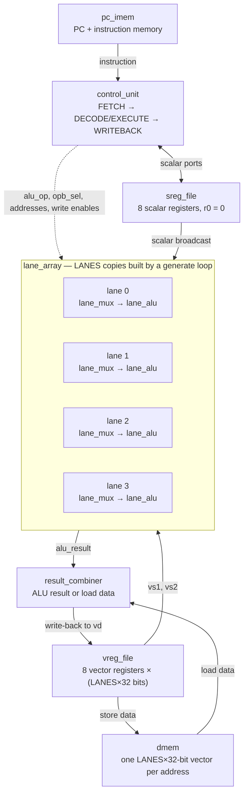
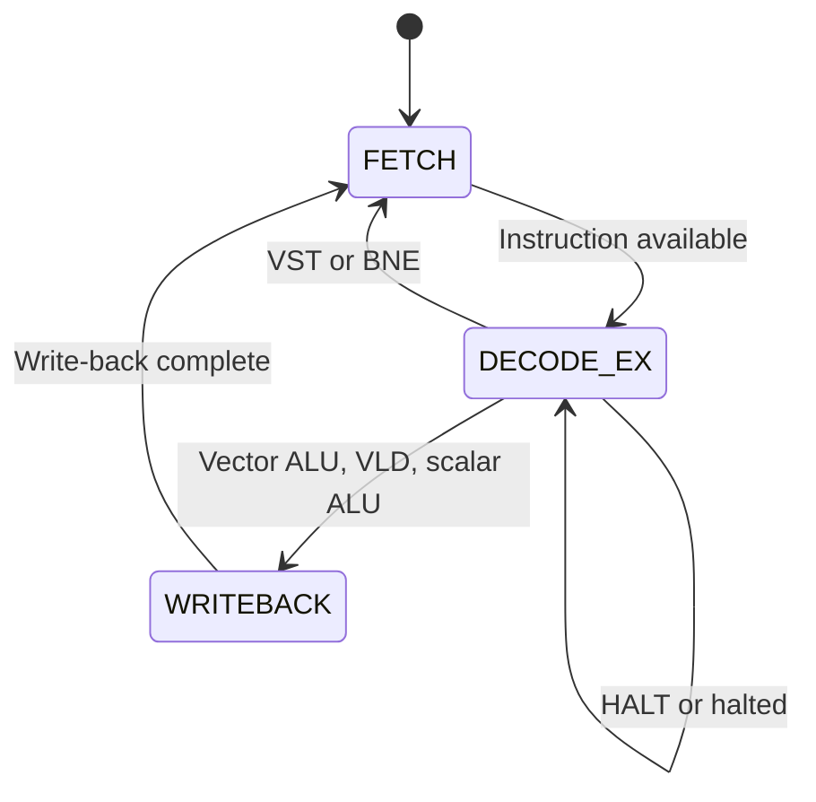

# SIMD Vector Processing Unit

**Project 11 · SIMD / Parallelism · Team LANE BREAKERS**
Modern Computer Architecture — Newton School of Technology, Rishihood University

A parameterized **Single Instruction, Multiple Data (SIMD)** vector processing unit in synthesizable Verilog-2001. One instruction drives every lane, so a 4-lane build performs four 32-bit operations in a single clock cycle. The core runs stored programs at 1, 2, 4 or 8 lanes from the same RTL, and reaches a **7.0–7.6× cycle-count speedup at 8 lanes** on three benchmarks.

---

## Submissions

> [!IMPORTANT]
> **Phase II — Final IEEE Report (PDF):** [report/SIMD_VPU_Phase2_Report.pdf](report/SIMD_VPU_Phase2_Report.pdf)
>
> **Phase I — IEEE Report (PDF):** [report/SIMD_VPU_Phase1_Report.pdf](report/SIMD_VPU_Phase1_Report.pdf)
>
> **Phase I — Prototype Demo Video:** [Phase I Prototype Demo (Google Drive)](https://drive.google.com/file/d/1J8yfL7EDzvQIP1-MFa14KIe3Ny5_jfE6/view?usp=sharing)

### Project Artefacts

| Artefact | Location |
|---|---|
| RTL source | [`rtl/`](rtl/) — 11 modules, including `control_unit` and `vpu_top` |
| Testbenches | [`tb/`](tb/) — unit, integration and system tests; `make test` prints `ALL PASS` |
| Assembler and benchmarks | [`verif/asm.py`](verif/asm.py), [`verif/programs/`](verif/programs/) — B1, B2, B3 |
| Golden model | [`verif/golden.py`](verif/golden.py) — reference outputs for every benchmark |
| Measured results | [`report/results.csv`](report/results.csv) — reproduced by `make bench` |
| Analysis and plots | [`report/analysis.md`](report/analysis.md), [`report/figures/`](report/figures/) |
| Design docs | [`docs/`](docs/) — spec, ISA, interfaces, control FSM, per-module docs |
| Synthesis flow | [`synth/run_synth.tcl`](synth/run_synth.tcl), [`synth/parse_reports.py`](synth/parse_reports.py) — Vivado, Artix-7 |

---

## Team

| Member | Role | Phase I | Phase II |
|---|---|---|---|
| **Dhanvin Vadlamudi** (Team Lead) | Datapath RTL | `lane_alu`, `lane_mux`, `lane_array`, `vreg_file`, `sreg_file`, `result_combiner` | `datapath_sweep_tb` (write-back and memory at 1/2/4/8 lanes), datapath docs |
| **Kasula Lalithendra** | Architecture & Integration | Spec, interfaces, block diagram, `vpu_demo_top`, Makefile | Phase I audit, `vpu_top` integration, smoke test, top-level docs |
| **Jagruthi Pulumati** | Control & Memory | ISA, control FSM design, `dmem`, `pc_imem` + tests | `control_unit` RTL and 577-check testbench, ISA / FSM docs |
| **Polana Rakshita** | Verification | `golden.py`, unit testbenches, verification plan | Assembler, benchmark programs, system testbench, `run_bench.py` |
| **Chaitanya Sai Meka** | Report & Synthesis | IEEE report, literature review | Vivado flow and parser, scaling analysis and plots, Phase II report |

---

## The Idea in One Picture

A scalar processor needs one instruction per element. A SIMD processor applies one instruction to every lane at once.

```
 Scalar: 4 instructions, 4 steps      SIMD, LANES = 4: 1 instruction, 1 step

   step 1:  1 + 10 = 11                         VADD v2, v0, v1
   step 2:  2 + 11 = 13                 ┌─────────┬──────┴──┬─────────┐
   step 3:  3 + 12 = 15                 ▼         ▼         ▼         ▼
   step 4:  4 + 13 = 17               lane 0    lane 1    lane 2    lane 3
                                      1+10=11   2+11=13   3+12=15   4+13=17
                                      └──── all four in ONE clock cycle ────┘
```

---

## Architecture

The VPU is a single-issue Harvard machine. Vector registers are flat `LANES × 32`-bit buses; lane *i* occupies bits `[i*32 +: 32]`. Changing the `LANES` parameter (1, 2, 4, 8) rescales the register file, lane array and memory width with no RTL edits.



`vpu_top` connects every block. The control unit fetches each instruction, reads scalar operands for addresses and branches, and drives the datapath; the dashed arrow is control. Phase I's `vpu_demo_top`, where the testbench drives control directly, is kept as a datapath demo. See [`docs/vpu_top.md`](docs/vpu_top.md) and [`docs/control_unit.md`](docs/control_unit.md).

### Modules

| Module | Function | Status |
|---|---|---|
| `lane_alu` | Combinational 32-bit ALU, 9 operations via 4-bit `alu_op` | Built + tested |
| `lane_mux` | Operand B: own `vs2` element, or scalar broadcast (`opb_sel`) | Built + tested |
| `lane_array` | `generate` loop creating `LANES` mux + ALU pairs | Built + tested at 1/2/4/8 lanes |
| `vreg_file` | 8 vector registers, async read, sync write | Built + tested |
| `sreg_file` | 8 scalar registers, `r0` hard-wired to 0 | Built + tested |
| `result_combiner` | Write-back select: ALU result or memory data | Built + tested |
| `dmem` | One `LANES×32`-bit vector per address | Built + tested |
| `pc_imem` | Program counter with branch + instruction memory | Built + tested |
| `control_unit` | FETCH → DECODE/EXECUTE → WRITEBACK FSM and decoder | Built + tested (577 checks) |
| `vpu_top` | Complete core: runs stored programs | Built + tested at 1/2/4/8 lanes |
| `vpu_demo_top` | Phase I datapath demo (testbench-driven control) | Built + tested |

### ALU operations

| `alu_op` | Op | Per lane |
|---|---|---|
| 0 | VADD | `a + b` (32-bit wrap-around) |
| 1 | VSUB | `a - b` |
| 2 | VAND | `a & b` |
| 3 | VOR | `a \| b` |
| 4 | VXOR | `a ^ b` |
| 5 | VSLT | `signed(a) < signed(b) ? 1 : 0` |
| 6 | VEQ | `a == b ? 1 : 0` |
| 7 | VSLL | `a << b[4:0]` |
| 8 | VSRL | `a >> b[4:0]` (logical) |

Setting `opb_sel = 1` broadcasts one scalar register to every lane: `VADD.S vd, vs1, rs2` → `vd[i] = vs1[i] + rs2`.

### Instruction format (32-bit)

```
 31      26 25   23 22   20 19   17  16  15              0
┌──────────┬───────┬───────┬───────┬────┬────────────────┐
│  opcode  │  vd   │  vs1  │  vs2  │opb │ imm / offset   │
│  [5:0]   │ [2:0] │ [2:0] │ [2:0] │sel │    [15:0]      │
└──────────┴───────┴───────┴───────┴────┴────────────────┘
```
Vector ALU ops, `VLD`/`VST`, scalar `SADDI`/`SLI`, `BNE`, `HALT`. Full table: [`docs/isa.md`](docs/isa.md).

### Control FSM

| Instruction class | States | Cycles |
|---|---|---|
| Vector ALU, `VLD`, `SADDI`, `SLI` | FETCH → DECODE/EXECUTE → WRITEBACK | 3 |
| `VST`, `BNE` | FETCH → DECODE/EXECUTE | 2 |
| `HALT` | FETCH → DECODE/EXECUTE, then hold | 2 |



---

## Phase II Results

### Benchmarks

Each benchmark processes 64 elements, and every stored output lane is checked against `golden.py` after `HALT`.

| Benchmark | Operation |
|---|---|
| B1 | `C[i] = A[i] + B[i]` |
| B2 | `C[i] = min(A[i], T)` — signed clamp using a compare mask and blend |
| B3 | `C[i] = (A[i] & M) ^ (B[i] << 2)` |

### Cycle counts and speedup (from `report/results.csv`)

| Lanes | B1 cycles | B2 cycles | B3 cycles | B1 speedup | B2 speedup | B3 speedup |
|---|---|---|---|---|---|---|
| 1 | 1032 | 1998 | 1437 | 1.00× | 1.00× | 1.00× |
| 2 | 520 | 1006 | 733 | 1.98× | 1.99× | 1.96× |
| 4 | 264 | 510 | 381 | 3.91× | 3.92× | 3.77× |
| 8 | 136 | 262 | 205 | **7.59×** | **7.63×** | **7.01×** |

The counts fit `cycles = fixed + per_group × (64 / LANES)`: B1 = 8 + 16 per group, B2 = 14 + 31, B3 = 29 + 22. Loop work shrinks as lanes are added, but setup and `HALT` do not, so speedup falls below the ideal (Amdahl's law). B3 has the largest fixed setup, so it scales least. Plots: [`report/figures/`](report/figures/); analysis: [`report/analysis.md`](report/analysis.md).

### Verification — `make test`

| Level | What is checked | Result |
|---|---|---|
| Unit | ALU, mux, register files, result combiner, memories, lane array at 1/2/4/8 lanes | 197 checks pass |
| Control | `control_unit_tb`: decode, timing, branches, halt | 577 checks pass |
| Integration | `vpu_demo_top_tb` (20 checks), `vpu_top` 5-instruction smoke test, `datapath_sweep_tb` at 1/2/4/8 lanes | All pass |
| System | B1, B2, B3, lane-independence and opcode-coverage programs at 1/2/4/8 lanes (20 runs) | All match golden |

The run ends with `ALL PASS`.

### FPGA synthesis

The Vivado flow (`synth/run_synth.tcl` + `synth/parse_reports.py`) synthesizes and routes `vpu_top` on the Artix-7 `xc7a35tcpg236-1` at each lane count. The sweep has not been run yet, so area and maximum clock frequency are future work.

---

## Phase I Results (datapath prototype)

### Working example — `VADD v2, v0, v1` at LANES = 4

```
  v0 = [ 1,  2,  3,  4]     lanes 0..3
  v1 = [10, 11, 12, 13]
       ────────────────
  v2 = [11, 13, 15, 17]     all four lanes written on ONE clock edge (35 ns)
```

The simulation waveform is Fig. 2 in the [Phase I report](report/SIMD_VPU_Phase1_Report.pdf).

### Phase I verification

| Testbench | Scope | Checks |
|---|---|---|
| `golden.py` | Golden-model self-test | PASS |
| `lane_alu_tb` | 9 ops + edge cases (0, −1, INT_MIN/MAX, overflow, shifts 0/31) | 37 |
| `lane_mux_tb` | Vector vs. scalar select | 9 |
| `lane_array_tb` | LANES = 1 / 4 / 8, lane independence, scalar broadcast | 7 / 26 / 50 |
| `vreg_file_tb` | All 8 registers, 2 read ports | 17 |
| `sreg_file_tb` | `r0 = 0` invariant | 14 |
| `result_combiner_tb` | ALU vs. load select | 2 |
| `dmem_tb` | Lane-group read / write | 9 |
| `pc_imem_tb` | Reset, increment, branch | 12 |
| `vpu_demo_top_tb` | Integrated datapath: VADD, VSUB, VAND, VSLT, overflow | 20 |
| **Total** | **11 RTL testbench runs** | **203 — all PASS** |

---

---

## How to Run

### Prerequisites
```bash
# macOS
brew install icarus-verilog python3
# Ubuntu / Debian
sudo apt install iverilog python3
```
Optional waveform viewer: GTKWave or Surfer.

### Run all tests
```bash
make test
```
Runs every unit, integration and system test at all lane counts and ends with `ALL PASS` (or `FAILED: <list>` and a nonzero exit).

### Run one benchmark on the full core
```bash
make system BENCH=b1 LANES=4      # BENCH: b1 b2 b3 independence coverage
make smoke LANES=4                # 5-instruction smoke test
```

### Reproduce the results table
```bash
make bench                        # rewrites report/results.csv
python3 report/plot.py            # redraws report/figures/ (needs: pip install reportlab)
```

### Run one testbench
```bash
# lane_alu
iverilog -o /tmp/la.vvp tb/lane_alu_tb.v rtl/lane_alu.v && vvp /tmp/la.vvp

# lane_array at 1, 4, 8 lanes
for L in 1 4 8; do
  iverilog -DLANES=$L -o /tmp/lar_L$L.vvp \
    tb/lane_array_tb.v rtl/lane_array.v rtl/lane_alu.v rtl/lane_mux.v
  vvp /tmp/lar_L$L.vvp
done

# integrated demo datapath
iverilog -s vpu_demo_top_tb -DLANES=4 -o /tmp/demo.vvp tb/vpu_demo_top_tb.v rtl/*.v && vvp /tmp/demo.vvp
```

### Waveform
```bash
make wave
```
Writes the four-lane B1 waveform to `docs/vpu_b1_L4.vcd`.

### Assembler and golden model
```bash
python3 verif/asm.py verif/programs/b1.s --lanes 4 -o /tmp/b1.hex   # assemble a program
python3 verif/golden.py --self-test                    # self-test
python3 verif/golden.py --bench B1 --lanes 4 --n 64    # one benchmark
python3 verif/golden.py --all                          # all benchmarks, all lane counts
```

### Synthesis (requires Vivado)
```bash
vivado -mode batch -source synth/run_synth.tcl   # vpu_top at LANES = 1, 2, 4, 8
python3 synth/parse_reports.py                    # collect utilization and timing
```

---

## Repository Layout

```
simd-vector-processing-unit/
├── rtl/        Synthesizable Verilog-2001 (11 modules)
├── tb/         Unit, integration and system testbenches (Icarus Verilog)
├── verif/      asm.py, golden.py, run_bench.py, benchmark programs and data
├── synth/      Vivado flow, constraints and report parser (Artix-7)
├── docs/       SPEC, ISA, interfaces, control FSM, decisions, verification, per-module docs
├── report/     Phase I and II reports, results.csv, analysis, plots
├── Makefile    make test · system · smoke · bench · wave
└── README.md
```

---

## Documentation

| Doc | Contents |
|---|---|
| [`docs/SPEC.md`](docs/SPEC.md) | Full project specification and phase plan |
| [`docs/isa.md`](docs/isa.md) | Instruction encoding and opcode table |
| [`docs/interfaces.md`](docs/interfaces.md) | Port contracts and bus layout |
| [`docs/block_diagram.md`](docs/block_diagram.md) | Datapath and signal flow |
| [`docs/control_fsm.md`](docs/control_fsm.md) | Controller state diagram and decode table |
| [`docs/control_unit.md`](docs/control_unit.md) | Control unit implementation |
| [`docs/vpu_top.md`](docs/vpu_top.md) | Integrated core |
| [`docs/decisions.md`](docs/decisions.md) | Design decision log |
| [`docs/verification.md`](docs/verification.md) | Verification strategy and test list |
| `docs/<module>.md` | One document per RTL module |
