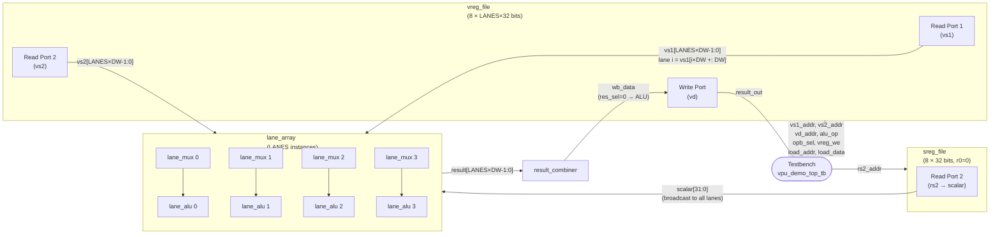

# Block Diagram — SIMD VPU Demo Datapath

**Module:** `vpu_demo_top.v`
**Owner:** Kasula Lalithendra (Role 1)

This is the Phase I demo datapath. The testbench loads two vectors into `vreg_file`, asserts `alu_op` and `opb_sel`, the `lane_array` computes all lanes **in the same cycle**, and the result is written back to a third vector register.

---

## Mermaid Block Diagram



---

## Signal Flow (one VADD operation, LANES=4)

| Cycle | What happens |
|-------|-------------|
| **Setup** | Testbench writes vector A to `v0`, vector B to `v1` via `load_we`. |
| **Execute** | `vs1_addr=0`, `vs2_addr=1`, `alu_op=4'h0` (VADD), `opb_sel=0`. `lane_array` computes `v0[i] + v1[i]` for lanes 0–3 combinationally. |
| **Writeback** | `vd_addr=2`, `vreg_we=1`. Rising clock edge writes result into `v2`. |
| **Readout** | `vs1_addr=2` reads `v2` back through `result_out`. |

One clock cycle per operation: execute and writeback happen in the **same cycle** (combinational ALU + synchronous write).

---

## Demo Datapath Connections (text schematic)

```
                        ┌──────────────────────────────────────────────┐
                        │              lane_array                       │
   vreg_file            │                                               │
  ┌──────────┐          │  lane i:                                      │
  │ rdata1   ├──vs1────►│  vs1[i×DW +: DW] ──────────────► lane_alu.a  │
  │ (vs1)    │          │                                   lane_alu.b ◄─lane_mux─┐
  │          │          │  vs2[i×DW +: DW] ──► lane_mux ──►            │          │
  │ rdata2   ├──vs2────►│                        ▲          lane_alu   │          │
  │ (vs2)    │          │                        │          .result    │   opb_sel│
  │          │          │  scalar ───────────────┘           │         │          │
  │ wdata ◄──┤          │                                    ▼         │          │
  │ (vd wb)  │          │  result[i×DW +: DW] ◄─────────────           │
  └──────────┘          └──────────────────────────────────────────────┘
       ▲                         │
       │                         ▼
       │                  result_combiner
       │                 (res_sel=0: ALU)
       └─────────────────────── wb_data
  
  sreg_file
  ┌──────────┐
  │ rdata2   ├──scalar──► (broadcast to all lane_mux instances)
  │ (rs2)    │
  └──────────┘
```

---

## Module List (Phase I)

| Module | File | Instantiates |
|--------|------|-------------|
| `vpu_demo_top` | `rtl/vpu_demo_top.v` | `vreg_file`, `sreg_file`, `lane_array`, `result_combiner` |
| `lane_array` | `rtl/lane_array.v` | `lane_mux` × LANES, `lane_alu` × LANES |
| `lane_alu` | `rtl/lane_alu.v` | — |
| `lane_mux` | `rtl/lane_mux.v` | — |
| `vreg_file` | `rtl/vreg_file.v` | — |
| `sreg_file` | `rtl/sreg_file.v` | — |
| `result_combiner` | `rtl/result_combiner.v` | — |
| `dmem` | `rtl/dmem.v` | — |
| `pc_imem` | `rtl/pc_imem.v` | — |
