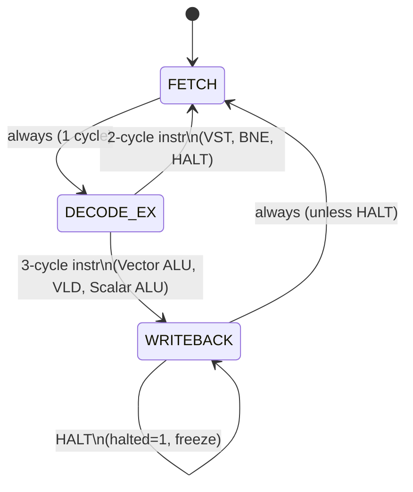

# Control FSM — Design Specification (Phase I)

**File:** `docs/control_fsm.md`
**Owner:** Jagruthi Pulumati (Role 3, Control and Memory)
**Note:** This document describes the FSM design only. RTL (`control_unit.v`) is built in Phase II.

---

## Overview

The VPU control unit is a **single-issue, non-pipelined Moore FSM** with 3 states. It decodes the fetched instruction and produces all datapath control signals. The same FSM drives every instruction type; cycle count varies only for 2-cycle vs 3-cycle instructions.

---

## State Diagram



---

## State Descriptions

### FETCH (1 cycle)
- `pc_imem` presents the current instruction on `instr`.
- `cycle_count` increments.
- `instr_count` increments.
- PC advance (`pc_en=1`) is registered — the new PC value takes effect next cycle.
- No register reads, no ALU activity.

### DECODE/EXECUTE (1 cycle)
- Instruction fields are decoded: `opcode`, `vd`, `vs1`, `vs2`, `opb_sel`, `imm`.
- `vreg_file` and `sreg_file` are read combinationally (async read ports).
- `lane_array` computes all lane results combinationally.
- `dmem` is addressed for VLD/VST.
- For VST: `dmem` write enable is asserted → data written to memory at end of this cycle.
- For BNE: branch condition evaluated; if taken, `branch_en=1` and `branch_target = PC + sign_ext(offset)`.
- For HALT: `halted` asserted; FSM loops in DECODE_EX (or transitions to WRITEBACK loop).

### WRITEBACK (1 cycle)
- For Vector ALU: `result_combiner` selects ALU result (`res_sel=0`), `vreg_file.we=1`.
- For VLD: `result_combiner` selects memory data (`res_sel=1`), `vreg_file.we=1`.
- For Scalar ALU: `sreg_file.we=1`, write computed result.
- For VST/BNE: `we=0`, nothing written — cycle effectively a no-op.

---

## Control Signal Decode Table

| Opcode | State sequence | `vreg_we` | `sreg_we` | `dmem_we` | `res_sel` | `pc_en` | `branch_en` | `halted` |
|--------|---------------|-----------|-----------|-----------|-----------|---------|-------------|---------|
| VADD..VSRL | F→DE→WB | 1 (WB) | 0 | 0 | 0 | 1 (F) | 0 | 0 |
| VLD | F→DE→WB | 1 (WB) | 0 | 0 | 1 | 1 (F) | 0 | 0 |
| VST | F→DE | 0 | 0 | 1 (DE) | — | 1 (F) | 0 | 0 |
| SADDI/SLI | F→DE→WB | 0 | 1 (WB) | 0 | — | 1 (F) | 0 | 0 |
| BNE (taken) | F→DE | 0 | 0 | 0 | — | 0 | 1 (DE) | 0 |
| BNE (not taken) | F→DE | 0 | 0 | 0 | — | 1 (F) | 0 | 0 |
| HALT | F→DE | 0 | 0 | 0 | — | 0 | 0 | 1 |

> F = FETCH, DE = DECODE/EXECUTE, WB = WRITEBACK. Signal asserted in the cycle noted.

---

## Cycle Count Summary

```
cycle_count increments every cycle from rst until halted.

Instruction             Cycles
─────────────────────────────
Vector ALU (any)          3
VLD                       3
VST                       2
SADDI, SLI                3
BNE (taken or not)        2
HALT                      2  (then frozen)
```

---

## Handoff for Phase II

The RTL `rtl/control_unit.v` will implement this FSM exactly. Ports will follow the interface contract in `docs/interfaces.md`. Key implementation notes:

- Use a 2-bit state register: `2'b00=FETCH`, `2'b01=DECODE_EX`, `2'b10=WRITEBACK`.
- Decode `opcode[31:26]` with a `case` statement to set all control signals combinationally in DECODE_EX.
- `cycle_count` and `instr_count` are 32-bit counters, reset by `rst`, frozen when `halted`.
