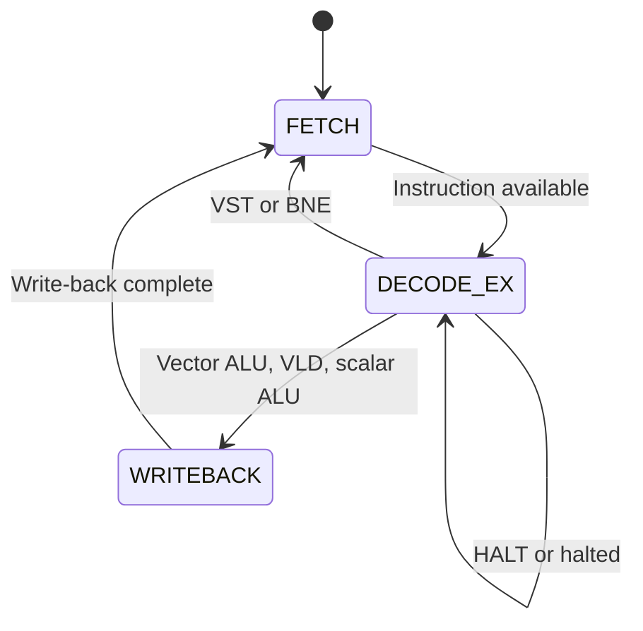

# Control FSM — Design Specification (Phase I)

**File:** `docs/control_fsm.md`
**Owner:** Jagruthi Pulumati (Role 3, Control and Memory)
**Note:** This document describes the FSM design only. RTL (`control_unit.v`) is built in Phase II.

## Overview

The VPU has a single-issue, non-pipelined controller with three states and a latched `halted` flag. Active instructions take two or three cycles.

## State Diagram

Synchronous reset returns the controller to FETCH, clears `halted` and both counters, and resets the PC to zero.

## State Descriptions

### FETCH (1 cycle)

- `pc_imem` presents the current instruction on `instr`. Latch it at the end of FETCH.
- Keep `pc_en=0` so the PC still points to this instruction during DECODE/EXECUTE.
- Increment `instr_count` once per fetched instruction, including HALT.

### DECODE/EXECUTE (1 cycle)

- Decode the saved instruction, read registers and compute the result or effective address.
- For VST, write the vector to data memory at the end of this cycle.
- For instructions that write a register, capture the result and destination for WRITEBACK. For VLD, include the data returned by the asynchronous memory read.
- For each non-HALT instruction, set `pc_en=1`. For a taken BNE, also set `branch_en=1` and set `branch_target` to the address of the BNE plus its sign-extended offset. With `branch_en=0`, the PC advances by one word.
- On HALT, keep `pc_en=0`, leave all write enables low, and set the latched `halted` flag at the end of this cycle. Stay in DECODE/EXECUTE with the PC, counters, and write enables held until reset. The PC remains at the HALT instruction.

### WRITEBACK (1 cycle)

- For vector ALU operations, select the saved ALU result with `res_sel=0` and assert `vreg_we`.
- For VLD, select the saved memory result with `res_sel=1` and assert `vreg_we`.
- For scalar ALU instructions, assert `sreg_we` and write the saved result.
- Hold the PC with `pc_en=0` and return to FETCH. VST, BNE, and HALT do not enter WRITEBACK.

## Control Signal Decode Table

| Opcode | State sequence | `vreg_we` | `sreg_we` | `dmem_we` | `res_sel` (WB) | `pc_en` | `branch_en` |
|--------|---------------|-----------|-----------|-----------|---------|---------|-------------|
| VADD..VSRL | F→DE→WB | 1 (WB) | 0 | 0 | 0 | 1 (DE) | 0 |
| VLD | F→DE→WB | 1 (WB) | 0 | 0 | 1 | 1 (DE) | 0 |
| VST | F→DE | 0 | 0 | 1 (DE) | — | 1 (DE) | 0 |
| SADDI/SLI | F→DE→WB | 0 | 1 (WB) | 0 | — | 1 (DE) | 0 |
| BNE (taken) | F→DE | 0 | 0 | 0 | — | 1 (DE) | 1 (DE) |
| BNE (not taken) | F→DE | 0 | 0 | 0 | — | 1 (DE) | 0 |
| HALT | F→DE, then hold | 0 | 0 | 0 | — | 0 | 0 |

F = FETCH, DE = DECODE/EXECUTE, WB = WRITEBACK. Enables are low outside the indicated state and while halted.

## Cycle Counts

`cycle_count` increments on each active cycle after reset, including the DECODE/EXECUTE cycle that sets `halted`. Subsequent cycles leave both counters unchanged until reset.

| Instruction | Cycles |
|-------------|--------|
| Vector ALU, VLD, SADDI, SLI | 3 |
| VST, BNE (either outcome), HALT | 2 |

## Handoff for Phase II

- Use a 2-bit state register (`2'b00=FETCH`, `2'b01=DECODE_EX`, `2'b10=WRITEBACK`) and a separate `halted` register.
- Use the saved instruction's opcode bits `[31:26]` in DECODE/EXECUTE. Branch control depends on the comparison result in that cycle.
- Follow port definitions in `docs/interfaces.md`. Both counters are 32-bit registers.
