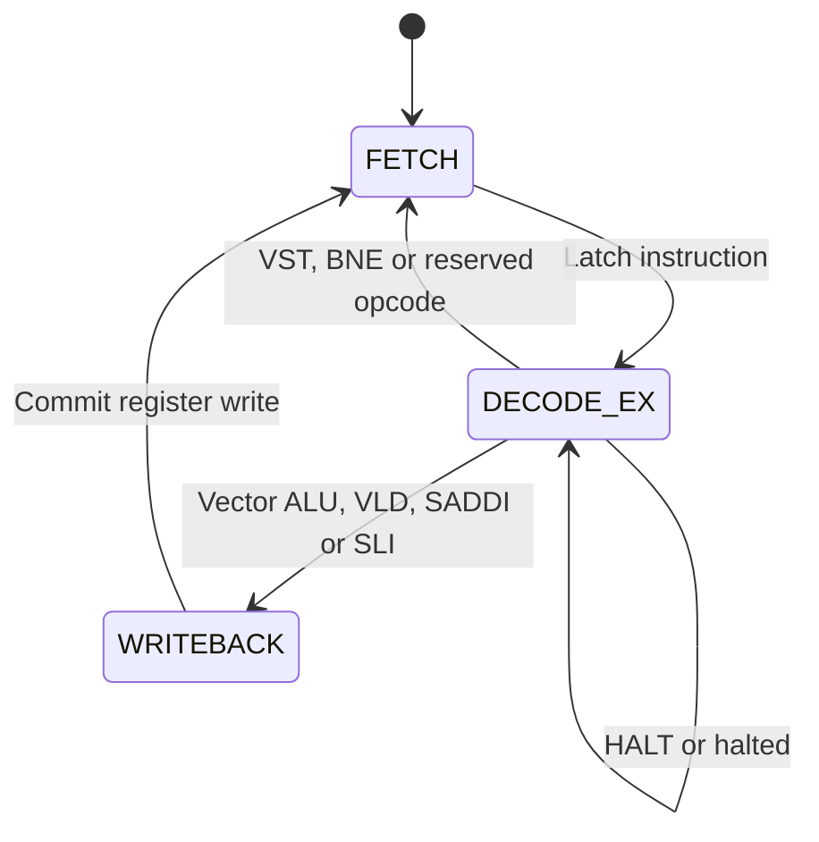

# Control FSM

The VPU issues one instruction at a time. A two-bit state register controls the three execution phases, and a separate flag holds the machine after HALT.

A rising edge with `rst=1` returns the controller to FETCH, clears `halted` and both counters, and resets `pc_imem` to address zero.

## Timing

1. **FETCH.** Latch the word from the asynchronous instruction output. Hold the PC and leave all writes disabled.
2. **DECODE/EXECUTE.** Decode the saved word, read operands and form the result, effective address, or branch decision. VST writes memory at the end of this cycle. All instructions except HALT update the PC at that edge. A taken BNE loads the BNE's own address plus the signed offset. Other instructions advance the PC by one. HALT sets `halted` and holds the PC at the HALT word. Register-writing instructions continue to WRITEBACK.
3. **WRITEBACK.** Write the selected vector result or saved scalar result and hold the PC. The destination and vector controls still come from the saved word, even though instruction memory is already showing the next word.

The rising edge that completes an instruction increments `instr_count` once, including HALT. `cycle_count` increments on every active edge after reset, including the edge that sets `halted`. HALT holds both counters on later edges. Reset disables writes and PC updates even when asserted during EXECUTE or WRITEBACK.

## Control outputs

| Instruction | States | `vreg_we` | `sreg_we` | `dmem_we` | `res_sel` | `pc_en` | `branch_en` |
| --- | --- | --- | --- | --- | --- | --- | --- |
| VADD through VSRL, including `.S` | F → DE → WB | WB | 0 | 0 | 0 | DE | 0 |
| VLD | F → DE → WB | WB | 0 | 0 | DE, WB | DE | 0 |
| VST | F → DE | 0 | 0 | DE | 0 | DE | 0 |
| SADDI, SLI | F → DE → WB | 0 | WB | 0 | 0 | DE | 0 |
| BNE, taken | F → DE | 0 | 0 | 0 | 0 | DE | DE |
| BNE, not taken | F → DE | 0 | 0 | 0 | 0 | DE | 0 |
| HALT | F → DE, then hold | 0 | 0 | 0 | 0 | 0 | 0 |
| Reserved opcode | F → DE | 0 | 0 | 0 | 0 | DE | 0 |

F is FETCH, DE is DECODE/EXECUTE, and WB is WRITEBACK. Each state takes one cycle. A state name in a control column means the signal is high in that state. The active vector ALU opcode and broadcast select are valid in DE and WB. See [Control unit](control_unit.md) for wiring and [ISA](isa.md) for instruction encoding and latency.
